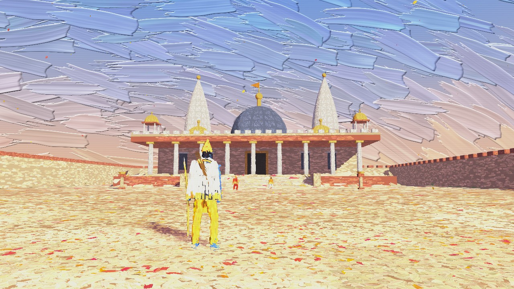
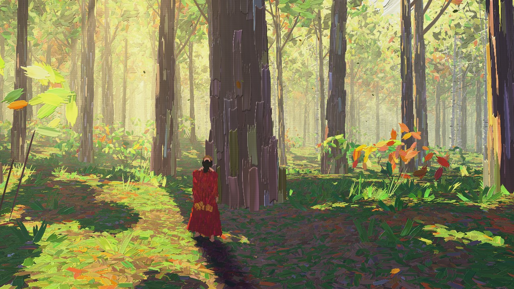
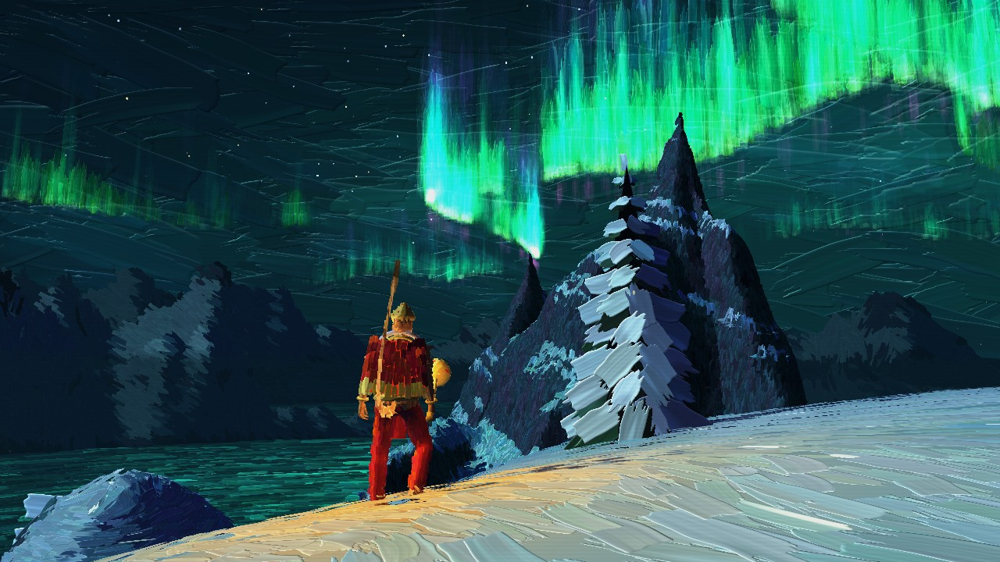
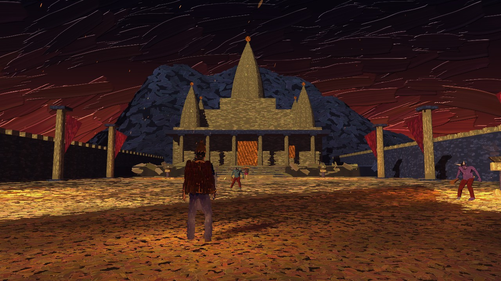
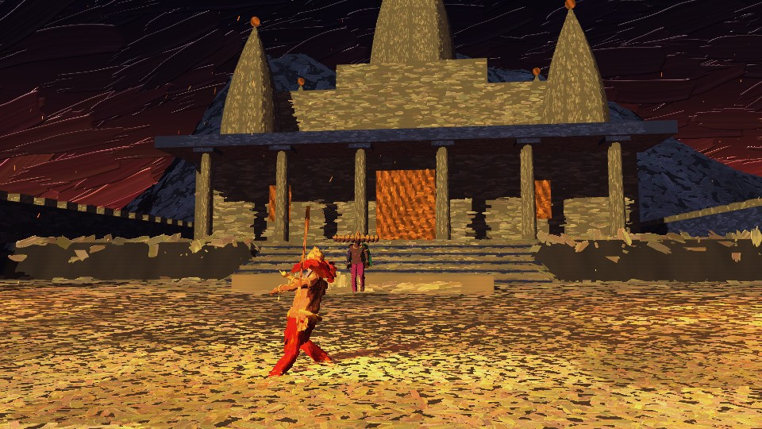
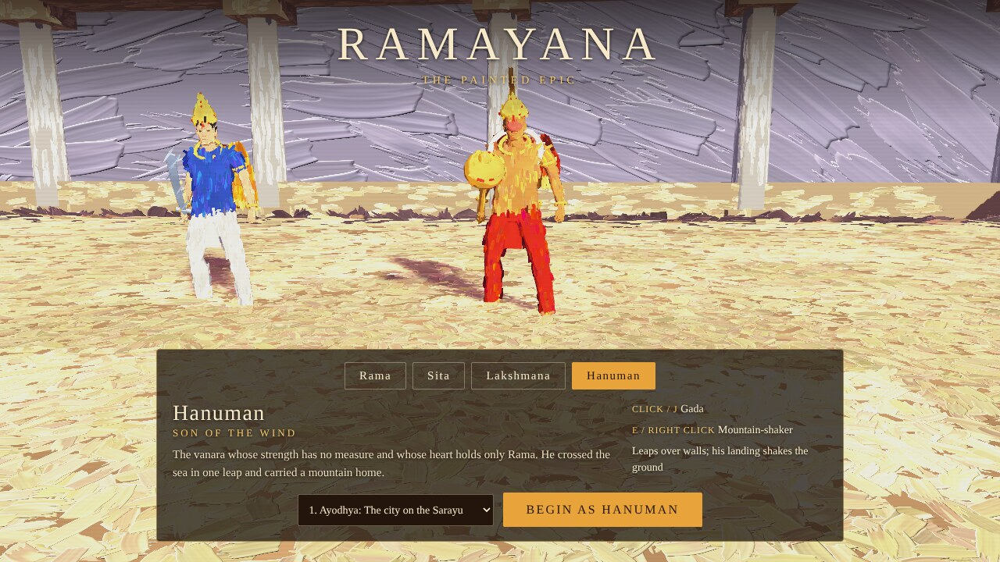

# Ramayana: The Painted Epic

A third-person adventure through four scenes of the Ramayana, drawn as thick oil paint, stroke by stroke. Choose who
to be (Rama, Sita, Lakshmana or Hanuman) and walk the tale from the court of Ayodhya to the gate of Lanka.

Nothing is filtered after the picture is drawn: every leaf, wall, crown and flame is a dab of the brush pinned to
the world. It runs in the browser on three.js 0.186 and WebGL2, with Rapier for physics.



| | |
|---|---|
|  |  |
|  |  |

## Play

```bash
npm install
```

```bash
npm run build
```

```bash
npm run serve
```

Then open <http://127.0.0.1:5405/>. `npm run dev` serves it from source instead, on port 5406.

| | |
|---|---|
| Look | Click the picture, then move the mouse |
| Move | `W` `A` `S` `D`; `Shift` to sprint; `Space` to jump |
| Strike | Click, or `J` |
| Special move | `E`, `K`, or right click |
| Step the eye back or in | Mouse wheel |
| Hide the hint | `H` |

A gamepad works too: left stick to move, right stick to look, `A` jump, `X` strike, `Y` special, click the left stick to sprint.
Add `?quality=low` to the address on a slower machine. There is no sound, and no touch controls.

## The heroes



| | Strike | Special | |
|---|---|---|---|
| **Rama**, Prince of Ayodhya | Kodanda: arrows, strong and far | Brahmastra: one blazing arrow that bursts | The archer |
| **Sita**, Daughter of the Earth | Lotus of light: thrown, stuns where it lands | Blessing of Bhumi: stuns and hurts all around her, and heals her | Holds foes off and outlasts them |
| **Lakshmana**, the Unsleeping Guard | Sword | Wheel of steel: a turning cut all round | Fast, at close quarters |
| **Hanuman**, Son of the Wind | Gada | Mountain-shaker: a great leap and a landing that shakes the ground | Jumps four times as high as anyone |

Their look follows Raja Ravi Varma's prints, which are shown on the chapter cards: Rama blue as a rain cloud in a
yellow dhoti under a tall gold crown; Sita in red silk bordered with gold; Lakshmana fair, in blue; Hanuman with his
red face, crown, mace and tail; Ravana dark and moustached under ten crowned heads.

## The tale

| Chapter | Where | What there is to do |
|---|---|---|
| 1. **Ayodhya** | The palace court at sunrise, petals in the air | Light the five lamps of the court, take leave of the others, and go out by the great gate |
| 2. **Panchavati** | The forest of Dandaka | Follow the golden deer. It is not a deer |
| 3. **Dronagiri** | A snow ridge of the Himalaya under the northern lights | Find the five glowing sprigs of Sanjeevani and carry them to the hermit's hut |
| 4. **Lanka** | The city of gold, by firelight | Fight up the road, through the gate, and face Ravana |

Progress and the chosen hero are kept in the browser. Any chapter can be started from the first screen, with any
hero: `?realm=lanka&hero=hanuman` goes straight there.

## How it was made

The eight steps this repo was built to, and where each one lives:

| Step | What | Where |
|---|---|---|
| 1 | three.js 0.186 + WebGL2 scene, third-person camera | `src/game/stage.js`, `src/figure/camera.js` |
| 2 | Rapier: walking, sprinting and jumping on the terrain | `src/figure/player.js`, `src/game/hero.js` (blows, the great leap) |
| 3 | MakeHuman: the base character from Patch's starter kit, and a MakeHuman woman put on the same skeleton | `public/figure/`, `src/game/rigs.js` |
| 4 | Quaternius' animation library and Patch's clips: idle, walk, run, jump; plus sword, mace, knock-down and rakshasa clips | `src/figure/animator.js`, `tools/make-assets.mjs` |
| 5 | GLSL: every object as brush strokes in three paint colours (light, half-tone, shade) | `src/oilpaint/`, `src/game/character.js`, `src/game/build.js` |
| 6 | GLSL: lighting, mist, falling snow and the aurora; petals over Ayodhya; fires and sparks over Lanka | `src/oilpaint/common.js`, `src/night/sky.js`, `src/game/motes.js`, `src/game/glow.js` |
| 7 | The snowy ridge, spruces and cabin, built of strokes (Dronagiri); and the palace, the forest hermitage and the fortress | `src/night/`, `src/realms/` |
| 8 | Patch: publish the playable game and the code | see below |

It starts from Patch's **oil-paint** block (`blendi/oil-paint`, MIT code and CC0 art), which is the painter, the
starter man and the two reference scenes. What this repo adds is the game: `src/game/` and `src/realms/`.

| | |
|---|---|
| `src/game/cast.js` | Who everyone is: palettes, what they wear and carry, what they can do |
| `src/game/character.js` | A body painted and dressed: crowns, bows, the gada, the tail, Ravana's heads, cloth |
| `src/game/rigs.js` | Loads the bodies and clips; puts the woman on the man's skeleton |
| `src/game/stage.js` | One realm, one hero: the loop, the camera, the hero's moves |
| `src/game/foes.js`, `combat.js`, `fx.js` | Rakshasas and Ravana; arrows and fire; sparks |
| `src/game/build.js`, `land.js`, `ground.js`, `sky.js` | Painted architecture, ground, and sky for any realm |
| `src/realms/` | Ayodhya, the forest, the Himalaya, Lanka, and the terrace where a hero is chosen |
| `tools/test.mjs` | Plays the built game headless and checks its rules (`npm test`, after a build) |
| `tools/shot.mjs` | Stills of any realm, headless |
| `tools/frame-pack.mjs` | Packs the built game for hosts that serve no `.glb` files (models as JSON, which `rigs.js` falls back to) |

## The website: Ramayana, retold

`site/` is a separate scroll-driven page that walks the story in five painted 3D scenes: an ashoka tree in flower, a
peepal leaf carrying Rama's vow, the lotus pond at Pampa (move the mouse to stir it), Hanuman's message on the floor of
the Ashoka grove, and the lamps of Ayodhya on the night of the return. A notes drawer tells the tale behind each scene.
Every picture is painted in code (`site/src/paint.js`); a gust of leaves carries one scene into the next, and a light
brush filter goes over the whole.


```bash
npm run site:build
```

The page is then in `site/dist`; `npm run site:dev` serves it from source on port 5410.

## A brand designer's portfolio, in the same style

`portfolio/` is a template portfolio built on the same painter as the Ramayana site: a tree in pink and lilac bloom
with stickers and an availability badge, project cards floating in the sky (scroll to bring each forward, open its
case study), a manifesto under water you can stir, a studio notebook page, and a contact scene. The name, projects,
links and every line of copy are in `portfolio/src/content.js`; the four projects there are invented samples.


```bash
npm run portfolio:build
```

The page is then in `portfolio/dist`; `npm run portfolio:dev` serves it from source on port 5411.

## A Blender model of Rama

`models/rama/` holds a separate, more detailed character: a rigged and textured Rama for Blender (`rama.blend`) and
for engines (`rama.glb`), with the script that builds it. See [models/rama/README.md](models/rama/README.md). The game
does not use it yet.

## Publishing on Patch

The game is ready to publish as a browser game (`dist/` with `index.html` at its top, every path relative, nothing
loaded from other hosts), but publishing needs your own Patch account, so it is yours to do:

```bash
npm i -g @patchgg/cli
```

```bash
pch login
```

```bash
pch init --files dist
```

```bash
npm run build
```

```bash
pch publish
```

`pch login` shows a code to approve at patch.gg; `pch publish` uploads `dist/`, and Patch tests the game once on your
PC in Patch Desktop before it goes live. `pch check` plays it locally first without uploading anything.

## Limits

- three.js on WebGL2 only. It has only been run on a software renderer so far, so its frame rate on a real GPU is
  untested. (The reference scenes it is built on are reported at about 4.5 ms a frame at 1080p on an RTX 4090.)
  `?quality=low` draws less.
- No sound, no touch controls, no saving inside a chapter (a fall puts you back at the last place you reached).
- Foes walk the ground and know nothing of trees or walls beyond the bounds each realm gives them.
- The men share one body and Sita another; faces are paint, not portraits.

## Credits

Code MIT. Art CC0 1.0 or public domain. Built on Patch's oil-paint block; characters from MakeHuman; movement from
Quaternius' Universal Animation Library; paintings by Raja Ravi Varma. Every part and its source is in
[CREDITS.md](CREDITS.md) and [LICENCE-NOTES.md](LICENCE-NOTES.md).
