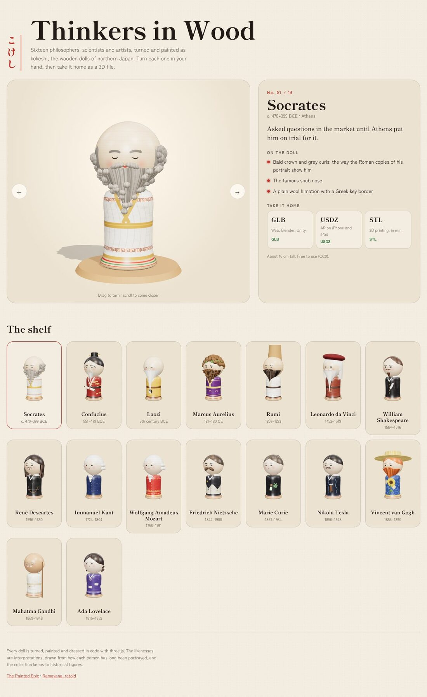
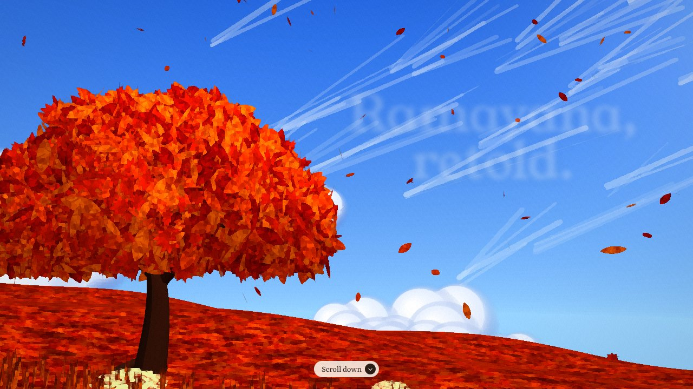
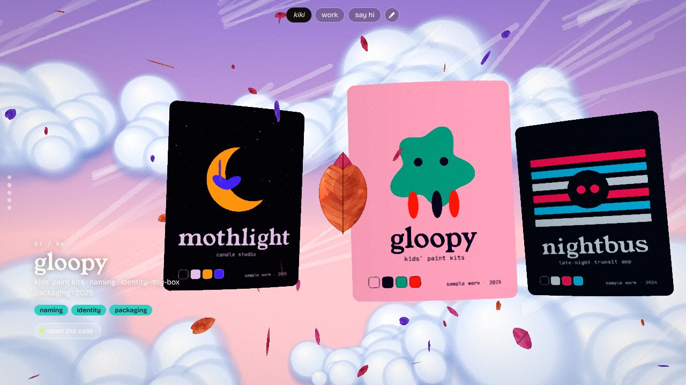

# Thinkers in Wood

Sixteen kokeshi of philosophers, scientists and artists, to turn in the browser and download as 3D models. This repo
is the website: the collection is its home page, and two painted pages live beside it.

| Path | Page |
|---|---|
| `/` | Thinkers in Wood, the kokeshi collection |
| `/ramayana/` | Ramayana, retold: a scroll-driven story in five painted scenes |
| `/portfolio/` | A brand designer's portfolio template, in the same painted style |

`kokeshi/` is a collection of sixteen kokeshi, the turned wooden dolls of northern Japan, of philosophers,
scientists and artists: Socrates, Confucius, Laozi, Marcus Aurelius, Rumi, Leonardo, Shakespeare, Descartes, Kant,
Mozart, Nietzsche, Marie Curie, Tesla, Van Gogh, Gandhi and Ada Lovelace. Every doll is built in code with three.js
(`kokeshi/src/kokeshi.js`): a lathe-turned body with the traditional red and green rings, a painted face, and the
details that make it someone (beard, hair, hat, spectacles, collar, something held) with a robe patterned from their
own work. What each detail stands for is listed in `kokeshi/src/dolls.js` and on the page.



Each doll downloads as **GLB** (web, Blender, Unity; metres), **USDZ** (AR on iPhone and iPad) and **STL** (3D printing;
millimetres), all about 16 cm tall. The files are made from the page itself and kept in `kokeshi/public/models`:

```bash
npm run kokeshi:build
```

```bash
npm run kokeshi:export
```

The exporter loads each GLB back and measures it before writing the next. The collection keeps to historical figures:
the likenesses are interpretations of how each has long been portrayed.

## Build and deploy

```bash
npm install
```

```bash
npm run build
```

`dist/` then holds the whole site: the collection at the top, `dist/ramayana/` and `dist/portfolio/` beside it.
`npm run dev` serves the collection from source. On Vercel, `vercel.json` sets the build command, the output folder,
trailing slashes and the models' content types, and sends the old `/kokeshi/` address to `/`.

## The website: Ramayana, retold

`site/` is a separate scroll-driven page that walks the story in five painted 3D scenes: an ashoka tree in flower, a
peepal leaf carrying Rama's vow, the lotus pond at Pampa (move the mouse to stir it), Hanuman's message on the floor of
the Ashoka grove, and the lamps of Ayodhya on the night of the return. A notes drawer tells the tale behind each scene.
Every picture is painted in code (`site/src/paint.js`); a gust of leaves carries one scene into the next, and a light
brush filter goes over the whole.



```bash
npm run site:build
```

The page is then in `site/dist`; `npm run site:dev` serves it from source on port 5410. It is also built into `/ramayana/` by `npm run build`.

## A brand designer's portfolio, in the same style

`portfolio/` is a template portfolio built on the same painter as the Ramayana site: a tree in pink and lilac bloom
with stickers and an availability badge, project cards floating in the sky (scroll to bring each forward, open its
case study), a manifesto under water you can stir, a studio notebook page, and a contact scene. The name, projects,
links and every line of copy are in `portfolio/src/content.js`; the four projects there are invented samples.



```bash
npm run portfolio:build
```

The page is then in `portfolio/dist`; `npm run portfolio:dev` serves it from source on port 5411. It is also built into `/portfolio/` by `npm run build`.

## A Blender model of Rama

`models/rama/` holds a separate, more detailed character: a rigged and textured Rama for Blender (`rama.blend`) and
for engines (`rama.glb`), with the script that builds it. See [models/rama/README.md](models/rama/README.md).

## Credits

Code MIT. Models and pictures CC0 1.0. Every part and its source is in [LICENCE-NOTES.md](LICENCE-NOTES.md).
