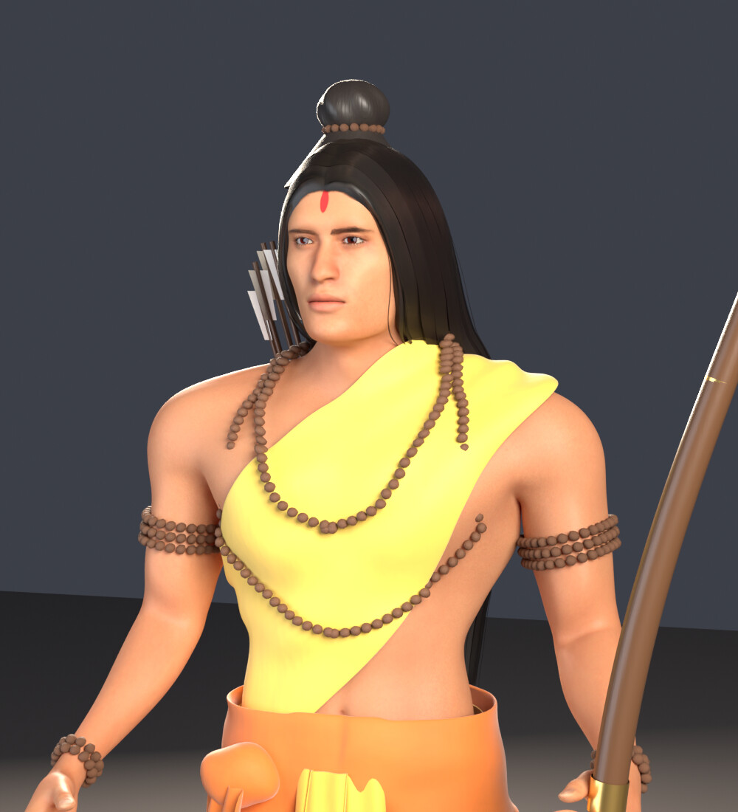
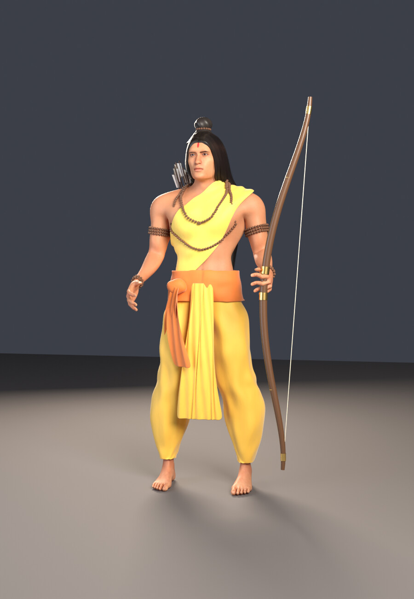
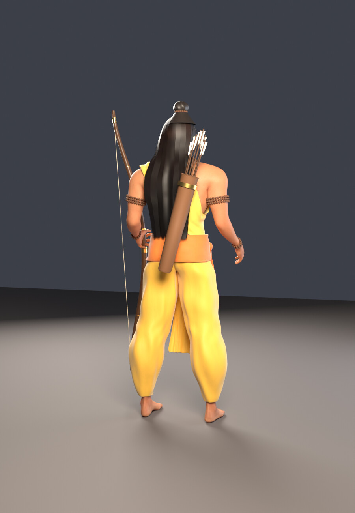

# Rama, a Blender character

A rigged, textured character of Rama as he is in exile: hair drawn up in a topknot, the tilak, two rudraksha malas,
bands of beads at arm and wrist, a cloth over the left shoulder, a pleated dhoti under an orange sash, the long bow in
his hand and a quiver on his back.



| | |
|---|---|
|  |  |

## Files

| | |
|---|---|
| `rama.blend` | The master copy, for Blender 5.x (made in 5.3). Textures are packed inside it. Lights, a floor and a camera are set up: press F12 |
| `rama.glb` | The same for game engines and three.js: cloth and smoothing made real, the rig and its weights kept. Its materials are simpler than the .blend's |
| `rama_*.jpg` | Stills rendered from the .blend with Cycles |

## What is in it

- **Body**: MakeHuman's base mesh (13,380 points, all quads), reshaped by its own morph targets into a tall, strongly
  built young man of 1.84 m. One level of subdivision is on it as a modifier; raise it for close-ups.
- **Face**: a long face, straight nose, firm jaw, level brows. These are this model's own features, chosen to suit how
  Rama is described and traditionally drawn. It is not modelled on any person.
- **Rig**: MakeHuman's game skeleton, 53 bones with the usual names (`pelvis`, `spine_01`..`03`, `upperarm_l`,
  `thigh_r`, fingers). Everything follows it. He is posed standing with the bow; clear the pose (Alt+R, Alt+G in pose
  mode) for the rest pose, arms out.
- **Skin, eyes, brows, lashes, teeth, long hair**: MakeHuman's system assets, with the skin warmed to a wheat-gold.
- **Clothes, beads, topknot, bow, quiver**: made in code for this model, each its own object with its own material,
  so any of them can be hidden, recoloured or replaced.

## Making it again

`tools/blender/build_rama.py` builds all of it from MakeHuman's open data, with no add-on to install:

```bash
pip install bpy
```

```bash
python tools/blender/build_rama.py --data <mpfb2>/src/mpfb/data --assets <makehuman_system_assets> --out models/rama
```

`<mpfb2>` is a clone of <https://github.com/makehumancommunity/mpfb2>, and `<makehuman_system_assets>` is the unzipped
"makehuman system assets" pack from <https://static.makehumancommunity.org/assets/assetpacks/makehuman_system_assets.html>.
The body's build and the face are the two tables near the top of the script (`human.macro(...)` and `FACE`); what he
wears is `tools/blender/rama_dress.py`.

## Limits

- It is a MakeHuman-class character: good for games, stills and animation at middle distance. It is not a film
  digital double: there is no sculpted skin detail, the hair is cards with a picture on them, and the cloth is shaped,
  not simulated.
- The cloth pieces carry the body's weights, so they follow a pose, but a deep bend will push the body through them.
- The stills here were rendered on a CPU at 128 samples.

## Licence

CC0 1.0, like its sources. The base mesh, morph targets and rig are MakeHuman's (released as CC0 in 2020; shipped with
MPFB2). The skin, eyes, eyebrows, eyelashes, teeth, tongue and hair are from MakeHuman's CC0 system assets pack.
Everything else was made in code for this repository.
